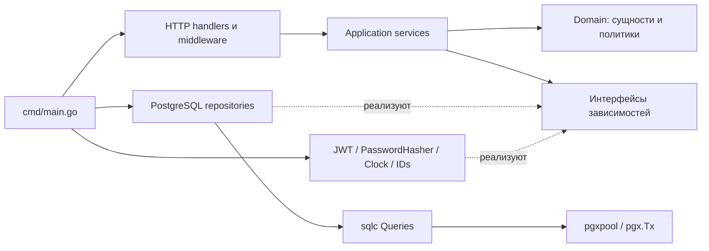

# User Service

План реализации: [продуктовые спринты и спецификации задач](tasks/README.md).
Этот план охватывает UserService; подключение JWT в ModelService/InferenceService
и llama.cpp UI в его задачи не входит.

Статус: спринты 01–04 реализованы. Подключение выданных JWT в
ModelService/InferenceService и llama.cpp UI остаётся отдельной задачей.
Текущий HTTP-контракт находится в `internal/api/router.go` и `internal/api/handler/dto.go`.

Сервис отвечает за учётные записи, аутентификацию, проекты, членство в проектах
и права доступа. PostgreSQL доступен через `pgx/v5`, SQL-запросы и типизированные
обёртки генерирует **sqlc**, как в inference-service. sqlc не создаёт соединения
и не запускает миграции: пул, транзакции и жизненный цикл принадлежат приложению.

## Текущее состояние

- Реализованы регистрация, вход, получение, список, изменение и удаление
  пользователей с учётом доступа к профилям и глобальной роли администратора.
- Реализованы создание, чтение, изменение и логическое удаление проектов по имени,
  а также назначение, список и удаление участников с защитой последнего тимлида.
- Реализован CRUD общего каталога проектных ролей: изменения выполняет только
  глобальный admin, а системный teamlead и назначенные роли защищены.
- Глобальный admin может назначать `user`, `analyst` и `admin`; изменение роли
  атомарно обновляет auth_version и не позволяет понизить последнего admin.
- Репозитории пользователей, проектов и ролей используют sqlc/pgx.
- Новые пароли хранятся в Argon2id PHC; legacy bcrypt принимается и
  переупаковывается при успешном входе. Очередь hashing ограничена.
- JWT подписывается RS256. Публичные ключи доступны через
  `GET /.well-known/jwks.json`; UserService проверяет актуальный auth_version
  и глобальную роль в БД для собственных защищённых операций.
- Глобальная роль хранится в `users.platform_role`, проектная — в `members`.
  Роли проектов и глобальные роли назначаются отдельными защищёнными API.
- Миграции `000001`–`000004` создают таблицы UserService, `000013` добавляет
  сведения об участнике и назначенной роли в журнал аудита существующей базы.
- Gateway вызывает `/internal/auth` перед запросами к моделям, однако этот
  обработчик проверяет только аутентификацию, без разрешений на конкретный проект.

## Согласованные требования

| Область | Решение |
| --- | --- |
| Глобальные роли | `user`, `analyst`, `admin`; администратор имеет полный доступ к платформе |
| Аналитик | Читает чужие проекты; в своих проектах дополнительно получает права роли из `members` |
| Сложение прав | Глобальные и проектные разрешения объединяются; readonly-грант аналитика не запрещает запись, разрешённую его проектной ролью |
| Проектные роли | Общий справочник `roles`, назначение через `members`; начальные роли `teamlead`, `developer`, `viewer` |
| Управление справочником | Только администратор платформы |
| Профили | Свой профиль, профили участников общих активных проектов; администратор видит всех |
| Идентификатор проекта | UUID в БД UserService, английское глобально уникальное имя во внешних вызовах и HTTP-маршрутах |
| JWT между сервисами | Проверка подписи и авторизация локально; допустимо действие старых прав до 5 минут |
| Первоначальная настройка | Обязательный sh-скрипт создания первого администратора в БД |
| Тесты на этапе реализации | Не более двух новых тестов, только основные сценарии |

`roles` содержит проектные роли. Глобальная роль хранится отдельно как
`users.platform_role` и не назначается через `members.role_id`.
Отдельное поле slug не вводится: `projects.name` является внешним именем проекта.
Изменения HTTP-контракта и новые операции управления участниками/глобальными
ролями описаны ниже; управление глобальными ролями пока не реализовано.

## Архитектура и зависимости



`domain` не импортирует HTTP, Huma, pgx, sqlc, JWT-библиотеку или конфиг окружения.
`service` содержит сценарии и принадлежащие им интерфейсы зависимостей.
`repository` преобразует строки sqlc в доменные типы и ошибки хранения в ошибки
приложения. Обработчики преобразуют DTO, вызывают сценарий и формируют HTTP-ответ.
`cmd/main.go` создаёт и связывает зависимости, а также закрывает ресурсы.

Порт в этой архитектуре — интерфейс Go, описывающий необходимую сервису
возможность. Например, PasswordHasher задаёт методы Hash и Compare;
адаптер с bcrypt или Argon2id реализует этот интерфейс. Сервис знает интерфейс,
а конкретная реализация передаётся через конструктор. Пунктирная стрелка
«реализуют» в диаграмме показывает эту связь. JWT, Clock и генератор ID
подключаются таким же способом.

Проверка прав входит в application service. Middleware устанавливает личность,
но не является единственным местом авторизации: вызов сервиса из другого
транспорта должен проходить ту же политику. Защищённый сценарий принимает
доверенный `Actor`, сформированный после проверки токена, отдельно от команды.
`actor.UserID` нельзя брать из тела запроса или произвольного `X-User-ID`.

```text
user-service/
  cmd/main.go
  internal/
    api/
      router.go
      handler/                  # DTO, преобразование ошибок, HTTP middleware
    domain/
      user.go                   # UserProfile, Credentials, AuthState, UserID
      platform_role.go          # User / Analyst / Admin, глобальные разрешения
      project.go                # Project, ProjectID, ProjectName
      membership.go             # Membership, правило последнего тимлида
      role.go                   # Role, Permissions, проверка действия
      errors.go
    service/
      auth_service.go           # Register, Login, Verify
      user_service.go           # Get, List, Update, Delete
      project_service.go        # Create, Get, List, Update, Delete
      role_service.go           # Create, Get, List, Update, Delete
      membership_service.go     # List, AssignRole, Remove
      platform_role_service.go  # Назначение глобальной роли администратором
      authorization_service.go  # Проверка проектных и административных прав
      ports.go                  # Интерфейсы репозиториев, Clock, IDs
    repository/
      user.go
      project.go
      membership.go
      role.go
      platform_role.go
      audit.go
      errors.go
      mapping.go
    infrastructure/
      dao/                      # Только сгенерированные sqlc-файлы
      password_hasher.go
      token_manager.go
      jwt_claims.go             # Преобразование grants в общий формат utils/authjwt
      tracing.go
      runtime.go                # Clock и генератор ID
  scripts/bootstrap-admin.sh
  cmd/bootstrap-admin/main.go   # Утилита, которую запускает sh-скрипт
```

Это целевое размещение файлов, а не требование создавать по пакету на каждый
интерфейс. Общий generic CRUD-репозиторий и единый сервис со всеми сценариями
не нужны. Сущность Project не загружает в память всех участников и все модели:
операции работают с необходимыми строками и проекциями.

## Доменные правила

### Пользователь

ID — ненулевой UUID; HTTP представляет его строкой. Email нормализуется один раз
по явно принятой политике сервиса: trim и lowercase всего адреса. Логин,
регистрация и изменение email используют одну функцию. В БД сохраняется
нормализованный адрес и действует уникальный индекс по `lower(email)`.
Имя и фамилия после trim непустые, допустим Unicode; верхние границы длины
должны совпадать в DTO и домене. Предлагаемые пределы: 100 символов на имя,
254 байта на email, 4 KiB на описание проекта, 64 KiB на JSON-тело запроса.

Профиль и credentials — разные типы и SQL-проекции. Запрос списка пользователей
не выбирает `password_hash`; хеш не попадает в публичные модели, DTO и логи.
`AuthState` содержит ID, состояние аккаунта и `auth_version`, без хеша пароля.
Также он содержит актуальную `platform_role`. Обычный профиль не открывает
глобальную роль другого пользователя: это поле доступно самому пользователю
и администратору. PasswordHash не возвращается ни при каких полномочиях.

PATCH изменяет только переданные поля. Пропуск, явный `null` и пустая строка
различаются: пропуск сохраняет значение, `null` для обязательного поля отвергается,
пустое имя/email отвергается, `description: ""` очищает описание. Для boolean
`false` — переданное новое значение. Нужен DTO с учётом присутствия полей;
одних `*string` недостаточно для различения отсутствия и JSON `null`.
Пустой PATCH — ошибка. Неизвестные поля отвергаются; `role`, `platform_role`, ID, даты,
`password_hash`, `auth_version` и назначения ролей через массовое присваивание
не изменяются.

### Проект и участник

Создатель проекта получает членство с ролью `teamlead`. Проект и первое
членство создаются одной транзакцией. Один пользователь имеет одну проектную
роль в каждом проекте, обеспеченную UNIQUE `(user_id, project_id)` в БД.
Отдельная роль owner и поле `owner_user_id` не нужны: управлять проектом
могут несколько тимлидов, а полномочия уже заданы проектными ролями.

У активного проекта должен оставаться хотя бы один участник с системной ролью
`teamlead`. Смена роли или удаление последнего тимлида возвращает `409`:
сначала назначается другой тимлид либо удаляется сам проект. Глобальная роль
администратора не считается членством и не заменяет этот инвариант.
Администратор может назначить нового тимлида в любом проекте без предварительного
добавления себя. Удаление аккаунта проверяет это правило во всех его проектах.

Внутренний `ProjectID` — UUID, FK в `members` также использует UUID.
Внешний `ProjectName` соответствует `projects.name`: от 1 до 63 символов,
строчная английская буква в начале, затем строчные английские буквы, цифры
и одиночные дефисы между частями. Регулярное выражение:
`^[a-z][a-z0-9]*(?:-[a-z0-9]+)*$`. Примеры: `demo`, `model-platform`, `project-1`.
Имя проверяется и в DTO, и в домене; невалидное имя не преобразуется
молчаливой заменой символов. Уникальность глобальная, независимо от создателя.

HTTP использует `/api/v1/projects/{project_name}`; сервис один раз разрешает
имя в UUID и продолжает сценарий по UUID. model-service и inference-service
получают это же значение как `project`, без отдельного slug и публичного UUID.
Например, `GET /api/v1/projects/demo` и `http://demo.qwen-small.localhost:8082/`
относятся к одному проекту. UUID сохраняется в текущем поле `id` ответа проекта,
но селектором публичных операций является `name`.

Имя проекта — неизменяемый внешний идентификатор. PATCH проекта изменяет
описание; переименование не выполняется одним UPDATE, поскольку затрагивает
другие сервисы, URL и browser storage. В целевом DTO поле `name` убирается
из UpdateProjectRequest; его передача возвращает `422`.
Имя логически удалённого проекта сохраняется и не переиспользуется, чтобы
старые данные, ссылки и права не перешли новому проекту.

### Глобальные и проектные роли

| Глобальная роль | Глобальные разрешения |
| --- | --- |
| `user` | Собственный аккаунт, создание проекта, доступ по членствам |
| `analyst` | Всё, что у user, плюс чтение метаданных всех активных проектов, моделей и deployments |
| `admin` | Все поддерживаемые операции платформы, любые проекты и профили, каталог ролей, назначение глобальных ролей |

При регистрации всегда назначается `user`, независимо от переданных полей.
`platform_role` изменяет только администратор через отдельную операцию;
обычный PATCH профиля не принимает это поле. Первого администратора создаёт
sh-скрипт bootstrap-admin с аудитом. Существующий обычный аккаунт этот скрипт
автоматически не повышает. Ни регистрация,
ни «первый зарегистрировавшийся» не дают административного доступа.

`roles` — общий каталог **проектных** ролей; его CRUD доступен администратору.
Назначение записи каталога конкретному участнику делает тимлид проекта
или администратор. Начальное наполнение ограничивается тремя ролями:

| Действие | `teamlead` | `developer` | `viewer` |
| --- | --- | --- | --- |
| Читать проект, модели и deployments | Да | Да | Да |
| Читать профили участников этого проекта | Да | Да | Да |
| Изменять описание и удалять проект | Да | Нет | Нет |
| Добавлять/удалять участников, назначать проектные роли | Да | Нет | Нет |
| Создавать, изменять и удалять модели | Да | Да | Нет |
| Запускать и останавливать deployments | Да | Да | Нет |
| Изменять глобальные роли и общий справочник | Нет | Нет | Нет |

`teamlead` имеет `all_permissions=true` в рамках проекта. Остальные начальные
роли используют существующие boolean-права. Чтение deployments относится
к чтению модели, чтение списка участников требует реального членства и доступа
к проекту либо глобального admin. При необходимости администратор может
добавить шаблон роли; каталог не копируется в каждый проект.

Права складываются объединением разрешений, а не числовым «приоритетом роли»:

```text
CanProjectAction(actor, project, action) =
    KnownAction(action) AND ActiveUser(actor) AND ActiveProject(project) AND (
        actor.platform_role == admin
        OR (actor.platform_role == analyst AND action IN ProjectReadActions)
        OR ProjectRoleGrants(actor.membership(project).role, action)
    )
```

`ProjectReadActions` — явный allowlist: чтение метаданных проекта, моделей
и deployments. Он не включает управление участниками, профили пользователей,
изменения, запуск/остановку или выполнение inference-запросов. HTTP GET сам по себе
не означает разрешённое действие; генерация ответа моделью не является readonly
просмотром метаданных. Права на выполнение inference нужно согласовать
с отдельным контрактом inference-service, а не выдавать через глобальный read.

`ProjectRoleGrants` требует членство и `role.all_permissions || flag`.
`false` — отсутствие дополнительного разрешения, а не явный запрет.
Например, `analyst + developer` читает чужие проекты и изменяет модели своего;
`analyst + viewer` читает все проекты, но не получает запись ни в один из них;
`user + teamlead` управляет своим проектом, но не чужими проектами или каталогом.
Глобальная роль не создаёт строки в `members` автоматически.

Системная роль `teamlead` имеет постоянный `system_key`, а не магический числовой ID.
Её нельзя удалить или лишить полного доступа: это нарушило бы правило тимлида.
ID ролей генерирует PostgreSQL identity; `MAX(id)+1` не используется.
Удаление назначенной роли возвращает `409`; FK `members.role_id` имеет
`ON DELETE RESTRICT`. Изменение общего шаблона меняет права всех назначений
и фиксируется в аудите. Не требуется отдельный глобальный конструктор ролей:
`user`, `analyst`, `admin` — фиксированные доменные значения.

Доступ администратора не отменяет доменные инварианты: нельзя оставить платформу
без администратора или активный проект без тимлида, раскрыть password hash,
изменить PK либо восстановить удалённый объект обходом проверки его состояния.
Проверки доступа выполняются на каждом запросе согласно
[OWASP Authorization Cheat Sheet](https://cheatsheetseries.owasp.org/cheatsheets/Authorization_Cheat_Sheet.html).

Назначение, отзыв глобальной роли и удаление пользователя сериализуются одной
транзакционной блокировкой реестра администраторов. В PostgreSQL-адаптере это
может быть `pg_advisory_xact_lock` с фиксированным ключом, скрытый за
`LockAdminRegistry`. После получения блокировки число администраторов читается
заново. Нельзя понизить или удалить последнего admin. Проверки только отдельной
строки пользователя недостаточно: два последних admin иначе удалятся одновременно.
Изменение глобальной роли увеличивает `auth_version`. UserService отклоняет
старые токены по своей БД; другие сервисы с локальной JWT-проверкой могут
принимать прежние права до истечения токена, максимум 5 минут.
Новый login выдаёт текущие права. В изменяющей транзакции
проверяется актуальная глобальная роль инициатора, а не снимок из JWT.

### Видимость профилей

```text
CanReadProfile(actor, target) =
    actor.id == target.id
    OR actor.platform_role == admin
    OR SharesActiveProjectMembership(actor, target)
```

Общий проект определяется двумя реальными строками `members` и активным
проектом. Доступ аналитика на чтение чужого проекта не считается членством.
Поэтому аналитик не видит профили и email произвольных людей из всех проектов.
Любой участник видит профили коллег, с которыми состоит хотя бы в одном проекте.
Ответ содержит предусмотренные DTO имя, фамилию, email и ID; credentials не
возвращаются. Отсутствующий или невидимый чужой профиль даёт `404`.

GET `/users` использует тот же предикат: admin видит всех, остальные — себя
и участников общих активных проектов. SQL применяет предикат через EXISTS
до LIMIT/OFFSET; несколько общих проектов не дублируют пользователя.
PATCH/DELETE чужого профиля разрешены только admin; общая проектная роль
и глобальный analyst не дают права редактировать коллег.
Ответы с профилями, списками участников и токенами получают
`Cache-Control: no-store`, чтобы общий кеш не выдал данные другого пользователя.

## Целевой HTTP-контракт

Общий префикс — `/api/v1`. Существующие 16 операций получают следующую
политику. UUID проекта в пути заменяется на `{project_name}`; UUID пользователя
и числовой ID проектной роли сохраняются. Request создания проекта по-прежнему
содержит `name`, `description`; name проверяется как внешний английский ключ.
Внутренние репозитории продолжают работать с ProjectID UUID.

| Метод и путь | Сценарий | Доступ и результат |
| --- | --- | --- |
| POST `/auth/register` | `AuthService.Register` | Публичный; нормализация, хеширование, INSERT RETURNING; `201`, занятый email `409` |
| POST `/auth/login` | `AuthService.Login` | Публичный; одинаковая ошибка неверных credentials; `200` с access token |
| POST `/auth/project-token` | `AuthService.IssueProjectToken` | Действующий Bearer и актуальная сессия; `{"project_name":"demo"}`; `200` с JWT для проекта без продления сессии |
| GET `/users` | `UserService.ListUsers` | Admin: все; остальные: себя и коллег по общим проектам; `200` |
| GET `/users/{id}` | `UserService.GetUser` | Свой профиль, admin или общий проект; `200`, отсутствующий/невидимый `404` |
| PATCH `/users/{id}` | `UserService.UpdateUser` | Сам пользователь либо admin; `200`; остальные `403`, занятый email `409` |
| DELETE `/users/{id}` | `UserService.DeleteUser` | Сам пользователь либо admin; защита последнего тимлида/admin; `204` |
| POST `/projects` | `ProjectService.CreateProject` | Авторизованный пользователь; проект + teamlead-membership в транзакции; `201` |
| GET `/projects` | `ProjectService.ListProjects` | Admin/analyst: все активные; user: доступные по членству; точный фильтр `name`; `200` |
| GET `/projects/{project_name}` | `ProjectService.GetProject` | Глобальное чтение либо проектное `can_read_project`; `200` |
| PATCH `/projects/{project_name}` | `ProjectService.UpdateProject` | Admin либо проектное `can_update_project`; меняется описание; `200` |
| DELETE `/projects/{project_name}` | `ProjectService.DeleteProject` | Admin либо проектное `can_delete_project`; логическое удаление; `204` |
| POST `/roles` | `RoleService.CreateRole` | Только admin; INSERT RETURNING; `201` |
| GET `/roles` | `RoleService.ListRoles` | Авторизованный пользователь; точный фильтр `name`; `200` |
| GET `/roles/{id}` | `RoleService.GetRole` | Авторизованный пользователь; `200` или `404` |
| PATCH `/roles/{id}` | `RoleService.UpdateRole` | Только admin; защита системного teamlead; `200` |
| DELETE `/roles/{id}` | `RoleService.DeleteRole` | Только admin; назначенная/системная роль `409`, иначе `204` |

Для управления согласованной моделью добавляются четыре операции:

| Метод и путь | Сценарий | Доступ и результат |
| --- | --- | --- |
| PUT `/users/{id}/platform-role` | `PlatformRoleService.SetRole` | Только admin; `{"platform_role":"analyst"}`; `200`, последний admin `409` |
| GET `/projects/{project_name}/members` | `MembershipService.ListMembers` | Admin либо участник с доступом к проекту; страницы профилей и назначенных ролей; `200` |
| PUT `/projects/{project_name}/members/{user_id}` | `MembershipService.AssignRole` | Admin либо `can_manage_members`; `{"role_id":2}`; новое членство `201`, замена/повтор `200` |
| DELETE `/projects/{project_name}/members/{user_id}` | `MembershipService.Remove` | Admin либо `can_manage_members`; `204`, отсутствующий участник `404`, последний тимлид `409` |

В записи platform-role допустимо одно значение `user`, `analyst` или `admin`.
Конструктор произвольных глобальных ролей не нужен.
Назначение существующего значения идемпотентно и не увеличивает auth_version.
Membership PUT не принимает имя глобальной роли и не даёт менять чужой профиль.
Пользователь не может сам вступить в проект; его добавляет уполномоченный участник
или admin. Начальные числовые ID ролей нужно получить через GET `/roles`,
пример `2` не означает закреплённый ID developer.

GET members имеет те же offset/limit/nextpagetoken и стабильный порядок,
что остальные списки. Аналитик без членства не получает список профилей чужого
проекта. Новые DTO и OpenAPI должны явно отражать эти ограничения.

UUID-маршруты проектов заменяются до выхода на production, без одновременного
угадывания UUID/имени в одном параметре. У новых/существующих локальных проектов
нужно проверить уникальность и формат имён; переименование локальных данных
согласуется с записями model-service/inference-service. Если их `project`
уже совпадает с projects.name, дополнительных идентификаторов не требуется.

Для проекта, невидимого пользователю, GET и операции по имени возвращают `404`,
чтобы не раскрывать существование чужого проекта. Если проект виден, но
конкретное действие запрещено, возвращается `403`. Списки ограничены правами:
user видит доступные по членству, admin и analyst — все активные проекты.
Недоступные объекты и их число в ответ не попадают. Повторный DELETE отсутствующего проекта
или роли — `404`; отдельная идемпотентность `204` текущим контрактом не обещается.

Числовой `nextpagetoken` сохраняется: он содержит следующий offset, а не JWT
или opaque cursor. Default limit 20, максимум 100, отрицательный offset запрещён.
SQL выбирает `limit+1` строк с устойчивым `ORDER BY created_at, id`, последняя
страница возвращает `null`, пустые списки — `[]`. Перед приведением Go `int`
к SQL INTEGER проверяется диапазон, включая `limit+1` и `offset+limit`.
Offset-пагинация может смещаться при конкурентных изменениях; cursor-пагинация
потребует отдельного изменения контракта и не подменяет существующее поле.

## Интерфейсы зависимостей и репозитории

Интерфейсы определяются потребностями сценариев; сгенерированный `Querier`
не становится публичным контрактом application layer.

| Порт | Основные операции |
| --- | --- |
| `UserRepository` | `Create` с возвратом строки, `GetAccessibleProfileByID`, `ListAccessibleProfiles`, `UpdateProfile`, `Delete` |
| `CredentialRepository` | `GetByEmail`, атомарное изменение credentials с увеличением `auth_version`, условный rehash |
| `AuthStateRepository` | `GetByUserID`, актуальная глобальная роль, активность аккаунта и версия токена без выборки хеша |
| `ProjectRepository` | `CreateWithTeamlead`, `GetByID`, `GetByName`, `ListAccessible`, `Update`, `MarkDeleted` |
| `MembershipRepository` | `ListMembers`, атомарные `AssignRole` и `Remove` с сохранением последнего тимлида, текущие права, общий проект |
| `RoleRepository` | `Create`, `Get`, `List`, `Update`, `Delete`, поиск системной роли по ключу |
| `PlatformRoleRepository` | Чтение/назначение users.platform_role, подсчёт admin, блокировка изменения глобальных ролей |
| `PasswordHasher` | Hash, Compare, NeedsRehash; реализации скрывают алгоритм |
| `TokenManager` | Подпись и проверка версионированных claims, глобальный и проектный access token |
| `Clock`, `IDGenerator` | UTC-время и генерация UUID с обработкой ошибки источника случайности |

`Credentials` и `UserProfile` могут обслуживаться одним PostgreSQL-адаптером,
реализующим несколько узких интерфейсов. Репозитории не вызывают HTTP,
не проверяют JWT и не выбирают политику доступа пользователя.

Сервис напрямую вызывает обычные методы репозитория. Чтения и простые изменения
выполняются одним sqlc-запросом в режиме autocommit. Отдельного менеджера
транзакций, интерфейса с callback и набора связанных репозиториев нет.
В PostgreSQL каждый отдельный SQL statement уже выполняется в транзакции;
без явного BEGIN успешный statement автоматически фиксируется, как описано в
[документации PostgreSQL](https://www.postgresql.org/docs/current/tutorial-transactions.html).

Связанные изменения представлены одним атомарным методом репозитория.
Например, `ProjectRepository.CreateWithTeamlead` сохраняет проект и первое
членство одним SQL statement с CTE и `INSERT ... RETURNING`. Ошибка вставки
участника откатывает также вставку проекта. Сервис не собирает эту операцию
из двух независимо коммитящихся вызовов разных репозиториев.

Если для конкретного изменяющего метода нужны несколько запросов и блокировки,
короткая транзакция полностью находится внутри этого метода репозитория.
Она не выходит в сервисный интерфейс. Авторизационные правила остаются
в service/domain; атомарные условия записи и проверки целостности обеспечиваются
репозиторием. Аудит записывается тем же атомарным методом, без отдельного
AuditRepository в зависимостях сервиса.

Текущий `CreateAccessToken(userID, expiresAt)` заменяется выпуском по типизированным
claims/grants: нужны глобальная роль, проектные permissions, времена сессии
и версии. JWT-адаптер преобразует доменные данные в wire-формат `utils/authjwt`;
бизнес-сервис не собирает JSON вручную и не зависит от криптографической библиотеки.

## sqlc и схема PostgreSQL

Целевые SQL-файлы:

```text
infra/postgres/queries/user-service/
  users.sql
  credentials.sql
  auth_state.sql
  projects.sql
  members.sql
  roles.sql
  platform_roles.sql
  audit.sql
  connection.sql
```

В существующий `infra/sqlc.yaml` добавляется второй элемент `sql`, сохраняя
набор inference-service. Пути считаются относительно этого файла:

```yaml
- name: user-service
  engine: postgresql
  schema: postgres/migrations
  queries: postgres/queries/user-service
  gen:
    go:
      package: postgres
      out: ../user-service/internal/infrastructure/dao
      sql_package: pgx/v5
      emit_empty_slices: true
```

Схема для sqlc берётся из миграций. Генерация
использует закреплённую в Makefile версию sqlc 1.31.1 и не требует рабочей БД.
Сгенерированные файлы коммитятся и не редактируются вручную.
Подключение pgx задаётся через `sql_package: pgx/v5`, как описано в
[документации sqlc](https://docs.sqlc.dev/en/v1.31.1/guides/using-go-and-pgx.html).

Репозиторий получает общий `*pgxpool.Pool` и создаёт `dao.New(pool)`.
Его обычные методы вызывают sqlc Queries напрямую, без ручного Begin/Commit.
Если отдельному методу нужна локальная транзакция, он использует
`queries.WithTx(tx)` внутри себя. Сервис не получает `pgx.Tx` и не управляет
commit. Механизм привязки Queries описан в
[документации sqlc](https://docs.sqlc.dev/en/v1.31.1/howto/transactions.html).
`pgtype.UUID`, nullable-поля, SQL-ошибки и строки DAO не выходят из repository.

INSERT и UPDATE используют явные колонки и `RETURNING`, без `SELECT *`.
Результатом Create/Update становится реально сохранённая строка, включая даты
и значения PostgreSQL. Профильные запросы перечисляют только безопасные поля.
Для DELETE применяется `:execrows` либо `DELETE ... RETURNING` с проверкой
отсутствия строки. SQL параметризован; значения и ORDER BY не собираются
конкатенацией пользовательского ввода.

| Таблица | Целевые поля и ограничения |
| --- | --- |
| `users` | UUID PK, email, firstname, lastname, password_hash, platform_role TEXT NOT NULL DEFAULT 'user', auth_version BIGINT, даты TIMESTAMPTZ; UNIQUE lower(email) |
| `projects` | UUID PK, name TEXT NOT NULL UNIQUE, description, deleted_at nullable, created_at/updated_at; имя резервируется и после удаления |
| `members` | UUID PK, user_id/project_id/role_id, created_at/updated_at; UNIQUE(user_id, project_id), локальные FK |
| `roles` | INTEGER GENERATED identity PK, UNIQUE name, nullable UNIQUE system_key, существующие boolean-права, даты |
| `audit_events` | UUID PK, actor ID, действие, тип/ID объекта, UTC-время, request/trace ID, безопасные изменённые поля |

Бизнес-валидация выполняется в Go. PK, UNIQUE, FK и NOT NULL обеспечивают
целостность при гонках и не заменяются предварительным SELECT. Индексы:
`users(created_at,id)`, `projects(created_at,id)`, `members(user_id,project_id)`,
`members(project_id)`, `members(role_id)`, `roles(created_at,id)`.
Частичный индекс по пользователям с `platform_role='admin'` позволяет быстро
проверять наличие других администраторов. Значения глобальной роли валидируются
в Go, без SQL ENUM/CHECK на перечень ролей.
Индексы под `name` добавляются по планам реальных запросов, без дублирования
уже существующих UNIQUE-индексов.

Членство удаляется вместе с физически удаляемым пользователем, но сценарий
сначала проверяет правило последнего тимлида во всех активных проектах.
Каждое изменение members блокирует строку проекта и перечитывает участников
после получения блокировки. FK не обеспечивает условие «хотя бы один тимлид».
Создание проекта, назначение членства и удаление пользователя синхронизируются
также строкой этого пользователя; нельзя добавить новое членство между проверкой
проекта и удалением аккаунта. Отдельных таблиц platform_admins и владельцев нет.

Другие сервисы не читают эти таблицы и не получают права на их изменение.
FK из models/deployments на users/projects не должен приводить к каскадному
удалению чужих ресурсов. Общий экземпляр PostgreSQL не отменяет границы сервисов.

Миграции пока не на production: при реализации можно привести начальные CREATE
к целевой схеме и убрать промежуточные ALTER, как разрешено в корневом AGENTS.md.
Нельзя просто раскомментировать всю старую цепочку поверх новой схемы.
Для существующей локальной БД нужен отдельный проверяемый план изменения без
потери данных: текущий runner пропускает уже записанные версии и не применит
правку ранее выполненного файла. Создание схемы с нуля и обновление существующей
БД проверяются отдельно. В будущем учёт версии миграции и её DDL должны
фиксироваться атомарно; сейчас runner выполняет их отдельными командами.

## Autocommit, атомарность и конкурентные изменения

По умолчанию репозиторий выполняет один SQL statement, PostgreSQL коммитит
его автоматически. Ручная транзакция не нужна для обычного SELECT,
INSERT RETURNING, UPDATE RETURNING или DELETE. Один statement с несколькими
изменяющими CTE также атомарен. Граница атомарности — метод репозитория.

| Сценарий | Что должно быть атомарно |
| --- | --- |
| Регистрация | INSERT пользователя и аудит; UNIQUE определяет победителя гонки email |
| Создание проекта | Проверка активного создателя, проект, первое teamlead-membership, аудит |
| Изменение проекта | Проверка актуальных прав, изменение строки, аудит |
| Изменение email/пароля | Credentials, увеличение auth_version и аудит |
| Удаление пользователя | Проверка последнего тимлида во всех проектах и последнего admin, удаление аккаунта и членств, аудит |
| Назначение глобальной роли | Проверка admin у инициатора, защита последнего admin, platform_role и auth_version у цели, аудит |
| Назначение/удаление участника | Проверка can_manage_members/admin, актуальная роль из каталога, сохранение последнего тимлида, изменение members, аудит |
| Изменение роли | Проверка административного доступа, защита системной роли, UPDATE и аудит |
| Удаление роли | Проверка доступа, DELETE с FK RESTRICT, аудит |
| Удаление проекта | Логическое удаление, исключение из доступа, сохранение имени, аудит; при интеграции — outbox-событие |

При необходимости локальной транзакции основной уровень изоляции —
READ COMMITTED с адресными блокировками внутри метода репозитория.
Проверка конкурентных условий и зависимая запись выполняются в одной транзакции; строки
членства и роли удерживаются совместимыми блокировками до commit. Для изменения
состава тимлидов используется блокировка строки проекта. Все операции,
способные менять соответствующий инвариант, обязаны соблюдать тот же протокол.
Чтение прав вне транзакции и последующий безусловный UPDATE оставляют TOCTOU.
Механика блокировок описана в [PostgreSQL Explicit Locking](https://www.postgresql.org/docs/17/explicit-locking.html).

Порядок блокировок закрепляется единым для изменяющих сценариев:
блокировка реестра администраторов
(если состав может измениться), строки пользователей по UUID, затем
строки проектов по UUID, членства и роли по ID. Участники операции включают
инициатора и затрагиваемых пользователей, а не только инициатора. При удалении
аккаунта блокируются все его активные проекты в одном порядке, затем число
оставшихся тимлидов перечитывается. Если конкретный сценарий
невозможно выразить тем же порядком, для него выбирается SERIALIZABLE с retry,
а не произвольное добавление блокировки. Изменение глобальной роли не должно
требовать загрузки и блокировки всех проектов в память.

Независимые поля PATCH обновляются одним SQL UPDATE с учётом присутствия полей,
без сохранения всей предварительно прочитанной сущности. Для конкурентной записи
одного поля пока действует last-write-wins: это ограничение текущего API.
При необходимости строгого контроля версия/ETag и `If-Match` согласуются
отдельно, с `412` для устаревшей версии.

Метод репозитория с локальной транзакцией проверяет ошибки Begin и Commit,
откатывает при ошибке и panic, освобождает соединение. Rollback использует
отдельный короткий контекст, если исходный уже отменён. Ошибка commit
не превращается в успешный ответ. У обычного autocommit-запроса проверяется
возвращаемая ошибка SQL, отдельного вызова Commit в Go нет.
Retry допускается только при известных `40001`/`40P01`: максимум три попытки
с jitter в пределах исходного deadline. Потеря соединения при commit может
означать неизвестный результат; такой запрос автоматически не повторяется.

Хеширование пароля, внешние вызовы и отправка событий не выполняются под
блокировками. Хеш и UUID готовятся до изменяющего вызова репозитория, аудит записывается в БД,
а публикация внешнего события выполняется после commit через outbox, когда
появится интеграция. Неограниченных повторов и фоновых записей с Background нет.

## Аутентификация и пароли

Для новых хешей предлагается Argon2id с версионированным PHC-представлением
и случайной солью на пароль. Начальный минимум — 19 MiB, 2 прохода, parallelism 1;
параметры и предел параллельного хеширования проверяются нагрузкой на целевом
контейнере. Старые bcrypt-хеши остаются проверяемыми и обновляются после
успешного входа условной записью `WHERE password_hash = old_hash`, чтобы
не затереть параллельную смену пароля. Это опирается на
[OWASP Password Storage](https://cheatsheetseries.owasp.org/cheatsheets/Password_Storage_Cheat_Sheet.html).

Текущая форма API 12–72 символа сохраняется до отдельного согласования политики.
Пароль не обрезается, не trim-ится и не нормализуется. Для legacy bcrypt отдельно
проверяется предел 72 **байта**, включая Unicode; Argon2id не наследует этот
предел. PHC-параметры проверяются перед выделением памяти, чтобы повреждённый
хеш не вызвал неограниченное потребление ресурсов. Вход для неизвестного email
проходит через dummy hash с теми же рабочими параметрами; ошибки login не
сообщают, существует ли аккаунт. Регистрация сохраняет предусмотренный API `409`.

JWT создаётся и проверяется библиотекой `github.com/golang-jwt/jwt/v5`.
Целевой формат и поведение потребителей описаны в следующем разделе.
Полноценные refresh/logout/MFA/email verification/password reset отсутствуют
в исходном API и не заявляются реализованными. При истечении access token
клиент выполняет login заново; продление пользовательской сессии без пароля
потребует отдельного контракта refresh, а не бесконечного перевыпуска access token.

## JWT для самостоятельной авторизации в других сервисах

Идея подтверждена: UserService подписывает JWT с данными авторизации,
а ModelService/InferenceService проверяют подпись и права самостоятельно.
Это устраняет обязательный запрос в UserService на каждую операцию.
Декодирование payload не является проверкой: права разрешено использовать
только после проверки подписи, обязательных claims и контекста ресурса.
Основания — [RFC 8725](https://www.rfc-editor.org/rfc/rfc8725.html)
и применение ролей/разрешений в [RFC 9068](https://www.rfc-editor.org/rfc/rfc9068.html).
Сервис не заявляется полноценным OAuth/OIDC-сервером: используем собственный
согласованный контракт access token на основе стандартного JWT.

### Подпись и распространение ключей

- UserService подписывает токен **RS256** приватным RSA-ключом минимум 2048 бит.
  Приватный ключ есть только у UserService и не передаётся другим сервисам.
- Другие сервисы получают публичные ключи через
  `GET /.well-known/jwks.json` на том же HTTP listener UserService.
  Endpoint публичный и не требует Bearer: он содержит только публичную часть
  ключей, как предусмотрено [RFC 7517](https://www.rfc-editor.org/rfc/rfc7517.html).
- JWT header содержит `alg: RS256`, `typ: at+jwt`, `kid`. Получатель разрешает
  только RS256 и выбирает соответствующий публичный ключ по kid.
  Адрес JWKS задаётся доверенным конфигом, не берётся из `jku`/`x5u` токена.
- JWKS кешируется с ограниченным TTL, например 60 секунд. При неизвестном kid
  допускается один ограниченный по времени refresh с защитой от частых запросов.
  Неизвестный ключ после успешного обновления означает `401`; отсутствие
  необходимых ключей из-за сбоя инфраструктуры — `503`, с отказом в доступе.
- При ротации новый публичный ключ публикуется до начала подписания им,
  старый сохраняется до истечения всех выпущенных им токенов. При уже
  загруженном ключе недоступность UserService не мешает локальной проверке.

Отдельный внутренний HTTP listener или mTLS для получения публичного ключа
не требуется. В production JWKS доставляется по доверенному HTTPS-адресу;
в локальной Docker-сети допустим `http://user-service:8080/.well-known/jwks.json`.
Gateway должен явно проксировать `/.well-known/jwks.json`: сейчас его общий
`location /` возвращает 404. Общий HS256-секрет из текущего Compose при переходе
заменяется публичными ключами у потребителей; смешанный fallback RS256/HS256
по данным неподтверждённого токена не используется.

### Claims и ограничение размера

Обязательные claims: `sub` (UUID пользователя), `username` (логин пользователя), `iss`, `aud`, `iat`, `exp`,
`auth_time`, `jti`, `auth_version`, `claims_version`, `platform_role`. JWT не содержит
email, имя, фамилию, пароль или хеш. Payload подписан, но не зашифрован.
`platform_role` — снимок `user`, `analyst` или `admin` на момент выдачи.

Чтобы не помещать все проекты пользователя в один растущий HTTP-заголовок,
токен содержит проектные разрешения максимум **одного** выбранного проекта.
Отсутствие `project` не означает доступ ко всем проектам: тогда действуют
только разрешения глобальной роли. Начальный login возвращает такой глобальный
access token; для работы по членству добавляется одна операция:

```text
POST /api/v1/auth/project-token
Authorization: Bearer <действующий access token>
{"project_name":"demo"}
```

Она проверяет токен и актуальное AuthState в UserService, находит активный проект
и текущее членство, применяет сложение прав и возвращает обычный AccessTokenResponse.
UserService выдаёт только разрешения из БД, не принимает от клиента role/permissions.
Без доступа к проекту — `404`; потерянная актуальность входного токена — `401`.
Перевыпуск для проекта не продлевает сессию: `exp` не позже exp входного токена,
`iat` — время выпуска нового JWT, `auth_time` остаётся временем исходного login.
Иначе такой endpoint позволил бы
бесконечно поддерживать сессию без повторной проверки credentials.

Пример payload токена аналитика, являющегося developer в demo:

```json
{
  "sub": "0197eb5a-37c6-7e48-8cd6-0c19edcd72f2",
  "username": "analyst",
  "iss": "user-service",
  "aud": ["user-service", "model-service", "inference-service"],
  "iat": 1793700000,
  "exp": 1793700300,
  "auth_time": 1793700000,
  "jti": "b330c10b-5508-48ed-8fbe-85190592985e",
  "claims_version": 1,
  "auth_version": 3,
  "platform_role": "analyst",
  "project": {
    "name": "demo",
    "role": "developer",
    "permissions": ["project.read", "model.read", "model.create", "model.update", "model.delete", "deployment.read", "deployment.start", "deployment.stop"]
  }
}
```

Здесь разрешения получены из актуальных boolean-полей роли. Имя роли — поясняющая
метка, а локальная проверка использует явно перечисленные permissions.
`all_permissions` тимлида раскрывается в список известных проектных действий,
а не в неограниченный wildcard. Неизвестные claims_version/глобальные роли/действия
не дают доступа. Максимальный размер JWT ограничивается, например 4 KiB;
ошибка формирования не приводит к усечению списка прав. Метаданные профилей
коллег в токен не помещаются; их видимость проверяет сам UserService по своей БД.

### Что делает получающий сервис

1. Берёт Bearer из HTTP Authorization или gRPC metadata `authorization`.
2. Проверяет подпись, фиксированные alg/typ, ожидаемый issuer, наличие своего
   имени в aud, обязательные exp/iat/auth_time/jti, допустимую длительность, UUID sub
   и поддерживаемую версию claims. Настройки парсера не зависят от payload.
3. Находит целевой ресурс и определяет реальный project_name на своей стороне.
   Например, GetDeploymentByID использует project записи deployment; клиентский
   project/UserID или имя поддомена не подменяют принадлежность ресурса и actor.
4. Разрешает действие по объединению: admin — все известные действия;
   analyst — allowlist чтения; `project.permissions` — дополнительные права,
   только если project.name в JWT в точности совпадает с проектом ресурса.
5. Без нужного разрешения возвращает `403` либо скрывающий ресурс `404`
   по согласованному контракту; неверный/истёкший токен возвращает `401`.

Поэтому analyst с project-token developer для demo изменяет demo и читает
остальные проекты, но не изменяет их. User с тем же project-token работает
только с demo. Admin/analyst могут использовать глобальный токен для действий,
разрешённых их глобальной ролью. Сервисы не обращаются к таблицам UserService.
Одинаковые DTO claims, валидация JWT и набор действий должны переиспользоваться
через небольшой общий пакет `utils/authjwt`, чтобы правила не расходились.
Доменная политика конкретного ресурса остаётся в его сервисе.

### Срок токена и изменение прав

Максимальный срок JWT — **30 минут**. `ACCESS_TOKEN_TTL=30m`;
получатель также отвергает токены с `exp - iat > 1800` секунд.
При проверке токена допускается расхождение часов в 30 секунд.

При изменении глобальной/проектной роли, шаблона роли, смене пароля или удалении
аккаунта другие сервисы могут использовать прежний снимок до exp. Это принятое
ограничение локальной проверки. Само поле auth_version не отзывает JWT в другом
сервисе без чтения текущего состояния: локальный сервис не знает новое значение.
auth_version нужен UserService для запрета дальнейшего получения project-token
по отозванной сессии после смены credentials/глобальной роли.

UserService проверяет собственную БД при своих защищённых изменяющих операциях,
выдаче JWT и project-token. Недоступность этой проверки даёт `503`, не `401`.
Выдача project-token перечитывает текущие права; удалённое членство не переносится
из входного JWT в новый. Для согласованного снимка user/members/roles используются
один SQL-запрос или локальная согласованная транзакция репозитория.
Уже выданный старый JWT остаётся пригодным для локальной проверки до exp.

Мгновенный отзыв потребовал бы introspection или распространения revocation state;
в базовой реализации этого нет. Также JWT не останавливает уже начатую генерацию
или открытый поток: если операция должна прекратиться точно при exp, сервис
ограничивает её deadline временем exp. Это правило нужно применить отдельно
к streaming HTTP и gRPC в inference-service, иначе окно активного доступа
может превышать срок токена.

Для смены credentials/глобальной роли и удаления аккаунта требуется недавний
login инициатора по auth_time. Project-token не обновляет auth_time; административная
смена пароля отзывает сессии цели в UserService и фиксируется в аудите.

### Переход с текущей реализации

Нынешний JWT содержит только sub/iss/exp и подписан HS256, поэтому сам по себе
не даёт другим сервисам нужной информации для проектной авторизации.
Реализация включает выпуск нового формата, JWKS, project-token и middleware
потребителей. Старые токены не преобразуются простым декодированием;
после совместного обновления сервисов пользователи выполняют login заново.
Это изменение контракта явно отражается в OpenAPI и gRPC metadata документации.

## Внутренняя авторизация и границы сервисов

`GET /internal/auth` остаётся адаптером проверки личности для gateway:
`204` и доверенный `X-User-ID`, `401` для неверного токена, `503` при недоступности
проверки. Он не выдаёт право на произвольный проект и не доверяет входному
`X-User-ID`. Отсутствие соединения с БД не означает разрешение доступа.

В базовой реализации UserService имеет один HTTP listener `:8080` для API
и JWKS. Отдельный внутренний listener, выделенный порт и обязательный mTLS
для локальной JWT-проверки не вводятся. Предложение о таком listener относилось
к UserService и его проверкам актуальных прав, а не к gRPC-порту InferenceService.

`/internal/auth` может остаться на том же listener для совместимости с nginx,
но его не нужно вызывать перед каждым запросом к моделям после подключения
локальных JWT middleware. Неиспользуемый internal handler можно убрать
при переходе gateway; его публичное наличие не даёт права подделывать principal.

Дополнительный `Authorize`/introspection endpoint нужен только при будущем
требовании немедленной актуальности прав. При согласованной задержке до пяти
минут обязательного такого API нет. Его появление потребовало бы отдельно
защитить доступ вызывающих сервисов и определить правила кеша/недоступности.

Проверки локального JWT и принадлежности ресурса обязательны и при прямом
обращении к ModelService/InferenceService. Gateway не заменяет эти проверки.
Он передаёт исходный Authorization, а получатель извлекает actor из проверенного
JWT. В gRPC токен передаётся в metadata; `user_id` в теле команды не является
доказательством личности. `X-User-ID`, присланный клиентом, не считается
доверенным principal. Поддомены модели также не являются авторизацией.

Порядок обновления: сначала реализовать и проверить JWT middleware потребителей,
обновить issuer/клиентов и настроить JWKS, затем убрать обязательный
`auth_request /_auth` на модельных маршрутах nginx. Нельзя отключать gateway-проверку,
пока сервисы за ним ещё принимают запросы без собственной проверки токена.

Удаление проекта в текущем HTTP-контракте возвращает `204` после логического
удаления метаданных и запрета новых операций. Оно не означает, что Docker-модели
уже остановлены. Перед production требуется согласовать завершение внешних
ресурсов: outbox `ProjectDeleted` + идемпотентные потребители либо отдельный
workflow удаления. Новые операции должны проверять существование и доступность
проекта, иначе гонка с удалением останется в других сервисах. Пока там нет этой
проверки, нельзя заявлять сквозную изоляцию или гарантированную очистку ресурсов.

## Ошибки и HTTP

Repository сопоставляет SQLSTATE и **конкретное имя ограничения**, сохраняя
причину через `%w`/`errors.Join`. Не любое `23505` означает занятый email.
`pgx.ErrNoRows` превращается в подходящую ошибку отсутствия; ожидаемый `23503`
при удалении назначенной роли — в конфликт. У неизвестной ошибки остаётся
внутренняя причина, но она не попадает в HTTP detail.

| Ситуация | HTTP |
| --- | --- |
| Невалидный JSON/неподходящий запрос | `400` |
| Ошибка схемы DTO: UUID пользователя, project_name, диапазон, неизвестное поле | `422`, как сейчас у Huma |
| Нарушение доменного формата/пустой PATCH | `400` |
| Нет/неверен/отозван токен, неверный login | `401`, для protected API с `WWW-Authenticate: Bearer` |
| Нет права на видимый объект/нужен повторный login | `403` |
| Объект отсутствует или чужой проект скрыт | `404` |
| Email/имя проекта/имя роли заняты, роль назначена, удаляется последний тимлид/admin | `409` |
| Превышен размер тела | `413` |
| Лимит запросов/дорогих операций | `429` с Retry-After |
| БД недоступна, исчерпан бюджет получения соединения | `503` |
| Истёк серверный deadline операции | `504`; уже отменённому клиенту ответ не обещается |
| Неизвестная ошибка | `500` |

Ответы используют единый Problem Details Huma с безопасным кодом причины
и request ID. SQL, DSN, email, пароль, хеш и токен в ошибку не включаются.
Нужно распространить защиту Huma validation values также на login:
сейчас трансформер обрабатывает регистрацию и update, но не login.
Авторизационные ошибки обрабатываются одинаково в middleware и handlers.

## Первоначальная настройка и первый администратор

Обязательная часть реализации — **`user-service/scripts/bootstrap-admin.sh`**.
Он создаёт в PostgreSQL первого пользователя с `platform_role=admin`
до начала работы с платформой. Это операторская процедура, без публичной
ручки «назначить первого admin» и без автоматического повышения первого
зарегистрировавшегося пользователя.

sh-скрипт служит точкой входа и запускает Go-утилиту
`user-service/cmd/bootstrap-admin`. Она переиспользует доменную валидацию,
PasswordHasher, PostgreSQL-пул и sqlc-запросы сервиса. Shell не реализует
хеширование и не собирает SQL конкатенацией значений. Утилита не запускает
HTTP-сервер, не выдаёт JWT и не требует приватного ключа подписи JWT.

Целевой порядок первоначального запуска из корня репозитория:

```sh
make up-database
sh user-service/scripts/bootstrap-admin.sh \
  --email admin@example.com \
  --firstname Platform \
  --lastname Admin
make up-user
```

Это команды для будущей реализации скрипта: на этапе README файл скрипта
и утилита ещё не созданы. DATABASE_URL передаётся через защищённое окружение
или файл секретов; для процесса на хосте используется доступный с хоста
адрес PostgreSQL, а не Docker hostname `postgres`.
Скрипт не применяет миграции сам и не изменяет конфиг других сервисов.

В интерактивном режиме пароль вводится дважды без отображения на терминале.
Для автоматизированной установки поддерживается `--password-stdin`, например:

```sh
sh user-service/scripts/bootstrap-admin.sh \
  --email admin@example.com --firstname Platform --lastname Admin \
  --password-stdin < /run/secrets/bootstrap_admin_password
```

Пароль не передаётся аргументом командной строки, не хранится в репозитории,
не выводится в stdout/stderr и не попадает в логи. `set -x` не используется.
Применяются тот же формат Argon2id и та же политика пароля, что в UserService;
в таблицу никогда не записывается plaintext. SQL использует параметры sqlc.

Правила выполнения:

1. Проверить входные данные, доступность и версию схемы. При отсутствии нужных
   таблиц/миграций завершиться с ненулевым кодом, без частичных изменений.
2. Получить и захешировать пароль до блокировок БД. В репозитории использовать
   короткую локальную транзакцию и тот же `LockAdminRegistry`, что у назначения
   глобальных ролей; после блокировки заново проверить наличие admin.
3. Если admin ещё нет и email свободен, создать пользователя с admin, сохранить
   аудит `bootstrap.admin.created`, проверить Commit и вывести только ID/результат.
4. Если пользователь с этим email уже admin, вернуть успешный no-op: пароль
   и профиль не перезаписываются. Это безопасный повтор первоначальной настройки,
   а не скрытый reset пароля.
5. Если первый admin уже существует с другим email либо указанный email занят
   обычным пользователем, завершиться с понятной ошибкой. Существующий обычный
   аккаунт автоматически не повышается. Следующих admin назначают через API.

Два одновременно запущенных скрипта не создают двух «первых» администраторов:
проверка после общей блокировки выполняется в той же транзакции, что INSERT.
При ошибке подключения, валидации, аудита или commit скрипт возвращает ненулевой
exit code. Установочного пароля по умолчанию и захардкоженных credentials нет.

## Запуск, эксплуатация и наблюдаемость

Один пул PostgreSQL создаётся в `main` через общий `utils/postgres.NewPool`.
Следом выполняются ограниченные по времени Ping/Check и проверка версии схемы.
До их успеха listener API не открывается. Дубли `infrastructure/database.go`
и настройки логгера заменяются общими utils, как в inference-service.
Для подключения локального Go-модуля utils потребуется изменить replace,
Docker build context UserService на корень репозитория и COPY зависимостей.

Предлагаемые дополнительные настройки; их ещё нет в конфиге:

| Настройка | Начальное значение/правило |
| --- | --- |
| `DB_CONNECT_TIMEOUT` | 5s |
| `DB_OPERATION_TIMEOUT` | 3s, в пределах request deadline |
| `DB_LOCK_TIMEOUT` | 1s, меньше бюджета операции |
| `SHUTDOWN_TIMEOUT` | 15s; Compose grace period с запасом |
| `ACCESS_TOKEN_TTL` | 30m; максимальный срок действия токена — 30 минут |
| `JWT_ISSUER` | user-service, одно точное значение для всех потребителей |
| `JWT_AUDIENCE` | Список допустимых потребителей: user-service, model-service, inference-service |
| `JWT_SIGNING_KEY_FILE` | Приватный RSA PEM только у UserService, через секрет |
| `JWT_ACTIVE_KID` | ID текущего ключа подписи |
| `JWT_JWKS_URL` | Доверенный URL публичных ключей в конфиге потребителей |
| Допуск расхождения часов при проверке JWT | 30s |
| `JWT_MAX_TOKEN_BYTES` | 4096; токен не растёт с количеством проектов пользователя |
| `HASH_MAX_CONCURRENCY` | По RAM/CPU контейнера и замерам |

В текущем Compose заняты публичные порты: UserService `8080`, ModelService
`8081`, HTTP-прокси InferenceService `8082`, gRPC InferenceService `9091`.
Для JWT/JWKS отдельный порт не добавляется. Если при реализации конфликтует
порт на хосте, можно изменить host mapping Compose и документацию адресов;
внутренние адреса контейнеров от этого не обязаны меняться. Порт `8083`
не является обязательной зависимостью UserService или InferenceService.

В production обязательны TLS с проверкой PostgreSQL-сервера, секреты вне образа,
отдельные роли БД для runtime и migrations и минимальные права на собственные
таблицы. Runtime не имеет DDL-прав. Общая сумма max connections всех реплик
учитывает лимит PostgreSQL; пул и очередь хеширования ограничены.
Statement/lock timeout задаются согласованно с контекстами и сбрасываются
корректно при использовании пула. Сервис не применяет миграции сам при старте.

Предлагаемые operational endpoints: `/healthz` проверяет процесс,
`/readyz` — готовность схемы/БД с коротким deadline и отсутствие shutdown.
Падение PostgreSQL снимает readiness, но не запускает бесконечный цикл рестартов
через liveness. Остановка: снять readiness, прекратить новые запросы, завершить
HTTP в ограниченное время, при необходимости закрыть соединения, затем закрыть
пул и выгрузить telemetry. Ошибка из run возвращается в main; Fatal/os.Exit
внутри функции с открытыми ресурсами не пропускает defer.

Rate limits обязательны для login/register, по IP и нормализованному идентификатору;
в нескольких репликах локальный limiter не является общим лимитом. IP берётся
только от доверенного ingress, произвольный X-Forwarded-For не принимается.
Выбор распределённого limiter/ingress — часть deployment-конфигурации,
постоянная блокировка аккаунта по попыткам не вводится как средство DoS.

Структурные логи содержат request/trace ID, route template, длительность,
исход и внутренний код ошибки. Тела auth-запросов, Authorization/Cookie,
пароли, хеши, DSN и значения SQL-параметров не логируются и не трассируются.
Метрики: latency/error rate по шаблону маршрута, pool acquire wait, занятые
соединения, длительность SQL по имени, очередь hash, login outcomes, отказы
авторизации. user ID, email и конкретный project не становятся labels метрик.

Аудит успешных изменений хранится в той же транзакции, доступен на запись
ограниченной роли БД и не удаляется каскадом с аккаунтом. Он содержит ID
инициатора и объекта, но не credentials или произвольное тело запроса.
Неуспешные login/authorization идут в безопасный security log с ограничением
частоты. Retention, экспорт аудита и резервное копирование задаются эксплуатацией;
restore из резервной копии проверяется до production.

## Порядок реализации и проверка готовности

1. Обновить DTO/OpenAPI по согласованной модели: project_name в маршрутах,
   глобальная роль отдельной операцией, управление участниками, видимость профилей.
2. Привести начальную схему и миграции к конечной форме; определить обновление
   локальной БД без потери данных. Добавить SQL-набор UserService в sqlc.
3. Реализовать доменные типы, ошибки, политики и интерфейсы репозиториев;
   затем PostgreSQL-адаптеры на sqlc с autocommit и атомарными методами записи.
4. Перевести существующие сценарии на эти адаптеры, реализовать GetUser,
   CRUD проектов и ролей, membership API и назначение глобальных ролей;
   убрать 501 из handlers и OpenAPI-описаний.
5. Реализовать JWT RS256/JWKS, project-token, локальную проверку у потребителей
   с принятым окном до 5 минут; добавить bootstrap-admin.sh и Go-утилиту создания admin.
6. Подключить общий lifecycle ресурсов, readiness, таймауты, ограничения нагрузки
   и аудит. Отдельно согласовать rollout внутренних проверок в других сервисах.

По согласованному ограничению на этом этапе добавляется **не больше двух новых
тестов**, только основные сценарии:

1. `TestUserRepositoryIntegration` (уже создан в спринте 01) проверяет
   пользовательские сценарии в изолированной PostgreSQL-схеме. В US-015 его
   нужно дополнить первоначальной настройкой admin и безопасным повтором.
2. Межсервисная авторизация: UserService выдаёт JWT, общий verifier другого
   сервиса проверяет его публичным ключом; analyst + developer изменяет свой
   проект, но не чужой, истёкший токен отвергается.

Отдельные тесты на каждый репозиторий, helper или все комбинации ролей пока
не добавляются. Существующие тесты не размножаются; необходимые ожидания
обновляются под изменённый контракт. Код bootstrap/JWT относится к следующему спринту.

Команды из корня репозитория при реализации:

```sh
make sql-check
make sql-generate
go -C user-service test ./...
go -C user-service test -race ./internal/service ./internal/repository
make lint
```

В CI генерация должна оставлять рабочее дерево без diff. Интеграционные тесты
работают с отдельной тестовой БД и не изменяют данные приложения. Проверка
чистой установки должна создавать все таблицы UserService из миграций.

Production-ready означает выполненные и проверенные свойства выше, включая
права на модели и границы внутренних endpoint, а не только успешные CRUD-запросы.
Миграция существующих имён/маршрутов и потребителей JWT, межсервисная проверка
объединённых прав и удаление ресурсов остаются явными условиями выпуска
до их реализации и проверки.

## Адреса текущего сервиса

- Swagger UI: <http://localhost:8080/api/v1/docs>.
- OpenAPI JSON: <http://localhost:8080/api/v1/openapi.json>.
- OpenAPI YAML: <http://localhost:8080/api/v1/openapi.yaml>.

`.env` читает launcher/Compose, а не Go-приложение. Секреты и реальные DSN
в этот документ не копируются; образец окружения — `.env.example`.

## Запуск и первоначальный admin

Перед запуском создайте RSA-ключ не короче 2048 бит и укажите путь к нему в
`JWT_PRIVATE_KEY_PATH` (в Compose — `JWT_PRIVATE_KEY_FILE`), `JWT_KEY_ID`,
`JWT_ISSUER` и `JWT_AUDIENCE`. Приватный ключ не отдаётся HTTP и не попадает в
образ. Для новой базы порядок такой: миграции PostgreSQL → ключ → bootstrap →
запуск UserService.

```sh
openssl genrsa -out user-service/keys/user-service-jwt.pem 3072
DATABASE_URL='postgres://…' ./scripts/bootstrap-admin.sh admin@example.com Admin User
```

Скрипт дважды запросит пароль без echo либо примет его из stdin. Повторный
запуск с тем же уже созданным admin безопасен и не меняет профиль или пароль.
Другой существующий admin либо занятый обычным пользователем email завершают
команду ошибкой. Liveness: `GET /healthz`; readiness БД и схемы:
`GET /readyz`.

Глобальный login выдаёт токен без project grant. `POST /api/v1/auth/project-token`
с Bearer-токеном и `{ "project_name": "demo" }` выдаёт ограниченный одним
проектом JWT; его срок не длиннее родительского. Контракт общих claims и
независимый verifier находятся в `utils/authjwt`. Ротация: добавить новый
public key в JWKS, начать подпись с новым `kid`, дождаться TTL старых токенов,
затем удалить старый key.
